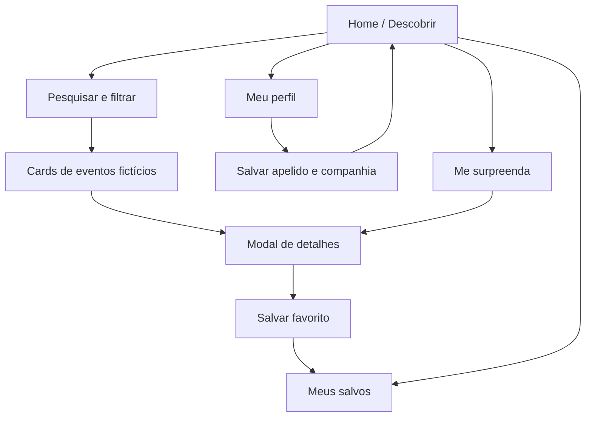

# Guia do projeto — GoOut

## Conceito visual

Identidade de pôster de festival: colagem, cards com borda preta e sombra deslocada, tipografia grande, cores vibrantes e elementos gráficos soltos.

### Tokens de cor

| Token CSS | Cor | Uso |
| --- | --- | --- |
| `--blue` | `#2449F5` | Primária: hero, botões e destaques |
| `--red` | `#EF3F47` | Secundária: adesivos e chamadas |
| `--yellow` | `#FFE55C` | Acentos e CTAs |
| `--pink` | `#FFAACB` | Seções, tags e decoração |
| `--lilac` | `#C9B1FF` | Contrastes visuais |
| `--lime` | `#D1F66C` | Tags e acentos |
| `--ink` | `#161522` | Texto, bordas e sombras |
| `--cream` | `#FAF7EE` | Fundo da página |

## Fluxo de navegação



## Componentes principais

### 1. Card de evento

**Onde está:** HTML montado por `cardHTML()` em `js/app.js` e estilizado pela classe `.event-card` em `css/styles.css`.

**Entrada:** objeto de `GOOUT_EVENTS` com `title`, `date`, `price`, `description`, `category`, etc.

**Ações:** botão coração chama `toggleFavorite(id)`; botão seta chama `openDetail(id)`.

### 2. Barra de filtros

**Onde está:** seção `.filter-panel` do `index.html`.

**Estado:** objeto `state` no `js/app.js`.

**Funcionamento:** cada mudança de controle atualiza o `state` e executa `render()`. A função `matching()` aplica restrições simultâneas e ordenação.

### 3. Modal de detalhes

**Onde está:** `<dialog id="eventDialog">` no `index.html` e funções `renderDetail(e)` / `openDetail(id)` do `js/app.js`.

**Ações:** salvar nos favoritos e compartilhar texto informativo. Não há venda de ingressos.

## Arquitetura atual e evolução

```text
Hoje:
Browser -> HTML / CSS / JS -> catálogo fictício em memória
                           -> localStorage (favoritos e perfil)

Evolução proposta:
Browser (Bootstrap + JS)
        |
        v
API REST (Node.js ou Python)
        |
        +--> Serviço de eventos / filtros
        +--> Serviço de recomendação
        +--> Persistência no PostgreSQL
        +--> Integrações externas (futuras)
```

A versão entregue é propositalmente somente o **front-end**: a arquitetura completa do relatório acadêmico ainda não foi implementada.

## Notas de manutenção

- As fotos ilustrativas são referenciadas por URLs externas do Unsplash e requerem internet.
- O campo `distance` é um valor de demonstração; não há geolocalização nem cálculo de rota real.
- O catálogo não deve ser publicado como agenda real.
- Ao integrar dados reais, validar disponibilidade, idade mínima, horários e origem das informações.
