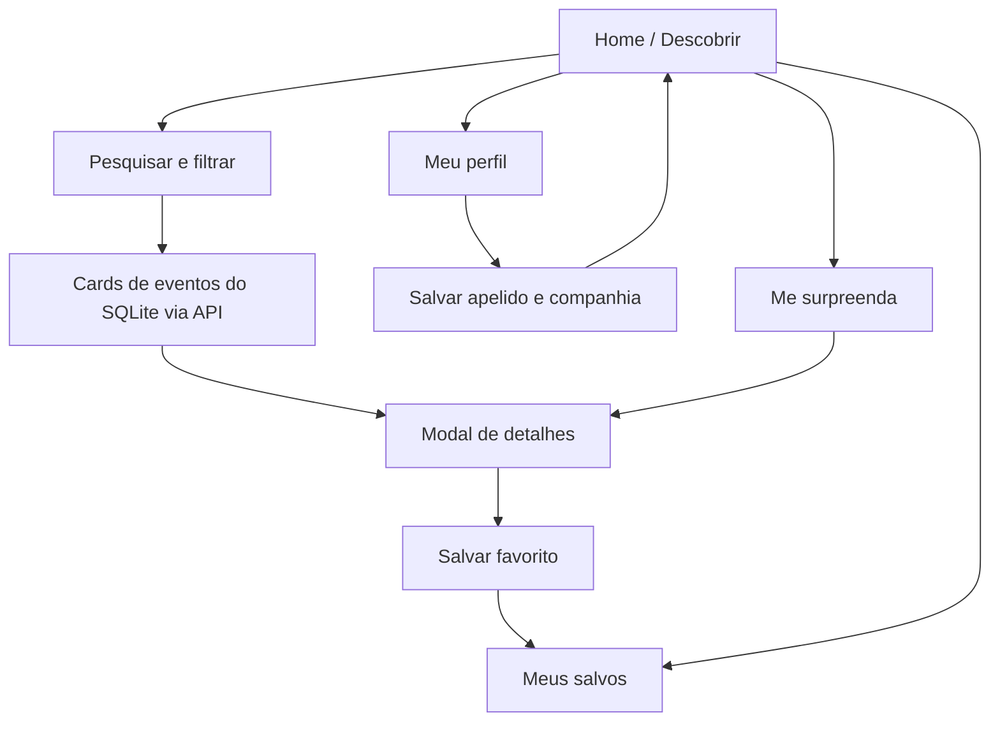

# Guia do projeto — GoOut

## Conceito visual

Identidade de pôster de festival: colagem, cards com borda preta e sombra deslocada, tipografia grande, cores vibrantes e elementos gráficos soltos.

### Tokens de cor

| Token CSS | Cor | Uso |
| --- | --- | --- |
| `--blue` | `#2449F5` | Primária: hero, botões e destaques |
| `--red` | `#EF3F47` | Secundária: adesivos e chamadas |
| `--yellow` | `#FFE55C` | Acentos e CTAs |
| `--pink` | `#FFAACB` | Seções, tags e decoração |
| `--lilac` | `#C9B1FF` | Contrastes visuais |
| `--lime` | `#D1F66C` | Tags e acentos |
| `--ink` | `#161522` | Texto, bordas e sombras |
| `--cream` | `#FAF7EE` | Fundo da página |

## Fluxo de navegação



## Componentes principais

### 1. Card de evento

**Onde está:** HTML montado por `cardHTML()` em `js/app.js` e estilizado pela classe `.event-card` em `css/styles.css`.

**Entrada:** objeto retornado por `GET /api/events`, com `title`, `date`, `price`, `description`, `category` e `is_demo`.

**Ações:** botão coração chama `toggleFavorite(id)`; botão seta chama `openDetail(id)`.

### 2. Barra de filtros

**Onde está:** seção `.filter-panel` do `index.html`.

**Estado:** objeto `state` no `js/app.js`.

**Funcionamento:** cada mudança de controle atualiza o `state` e executa `render()`. A função `matching()` aplica restrições simultâneas e ordenação.

### 3. Modal de detalhes

**Onde está:** `<dialog id="eventDialog">` no `index.html` e funções `renderDetail(e)` / `openDetail(id)` do `js/app.js`.

**Ações:** salvar nos favoritos e compartilhar texto informativo. Não há venda de ingressos.

## Arquitetura atual e evolução

```text
Browser -> HTML / CSS / JS -> API REST (Express)
                                  |
                                  +--> SQLite (eventos e favoritos anônimos)
                                  +--> Rotas administrativas protegidas por token

Evolução futura:
API REST -> fonte externa de eventos (quando houver acesso documentado)
        -> autenticação de usuários e perfis multi-dispositivo
        -> recomendação personalizada
```

O banco começa com eventos fictícios para demonstração; o CRUD de eventos é feito pelas rotas administrativas e exige `ADMIN_API_TOKEN`. A busca pública de eventos da Eventbrite não está integrada.

## Notas de manutenção

- As fotos ilustrativas são referenciadas por URLs externas do Unsplash e requerem internet.
- O campo `distance` é informado no cadastro; não há geolocalização nem cálculo de rota real.
- Os exemplos de demonstração não devem ser publicados como agenda real.
- Ao integrar dados reais, validar disponibilidade, idade mínima, horários e origem das informações.
- Em hospedagem, manter o arquivo SQLite em volume persistente e guardar o token administrativo como segredo do ambiente.
